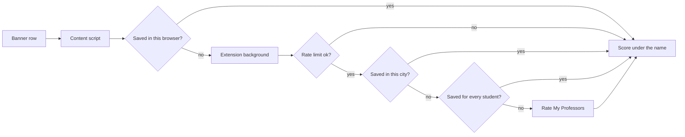
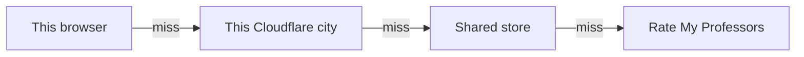
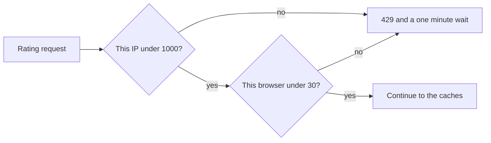

# How a rating gets onto the page

The picture below is the whole ratings path. The word list under it is the vocabulary. The tables after that name the file for each step. `docs/spec.md` is the copy the coding agent uses. If the two disagree, the code wins.

## The picture

A student is looking at one instructor on the St. John's class search page. The extension checks the closest saved answer first and only calls Rate My Professors on a full miss.

A new answer is saved on the way back. The browser keeps it. The city cache keeps the batch. The shared store keeps a matched profile. A failure is shown and not saved.

## Words

Two different things are both called a worker. The extension background is a Chrome service worker. The server is a Cloudflare Worker.

### On the page

| Word | Meaning |
| --- | --- |
| Banner | The St. John's class search page. The results table is replaced in place when the student searches, pages, or sorts. |
| Content script | Code that runs inside that page. It can read the table. It cannot call Rate My Professors itself. |
| Chip | The line this extension draws under the instructor name. |
| Extension background | The Chrome service worker in `extension/src/service-worker.ts`. It does the network call. Chrome can shut it down after 30 idle seconds. |

### Saved answers

| Word | Meaning |
| --- | --- |
| Cache | A saved answer, so the next request can skip a slower step. |
| Cache key | The name of one instructor in a cache. Same name in two subjects gets two keys. |
| cacheVersion | A number at the front of the key. Raising it makes old saved answers miss on purpose. |
| Local storage | `chrome.storage.local`. Saved on this browser only. |
| Session storage | `chrome.storage.session`. Cleared when the browser closes. Used for short timers. |
| Sync storage | `chrome.storage.sync`. Holds the show and hide switch. |

### On Cloudflare

| Word | Meaning |
| --- | --- |
| Worker | Our server. `worker/src/index.ts` is the front door. |
| Colo cache | A cache in the Cloudflare city that handled the request. In code this is `caches.default`. |
| KV | A shared key-value store. Every browser can read it. The binding name is `RATINGS`. |
| Durable Object | One object that holds the rate-limit counts, so two cities do not keep two different counts. |
| Rate limit | A cap on how many rating requests are allowed in one minute. |
| Client id | A random id for this browser, sent as `X-Client-ID`, so the cap can tell browsers apart. |
| 429 | The HTTP status for "slow down". The body is empty. |
| Wrangler | The tool that configures and deploys the Worker. `worker/wrangler.toml` is its config. |

### What the chip can say

| Word | Meaning |
| --- | --- |
| rated | A matched profile that has ratings. |
| unrated | A matched profile with zero ratings. |
| not_listed | No matching profile. |
| unavailable | The lookup failed, or the rate limit said to wait. This one is not saved. |
| exact | One clear match. |
| possible | A match, but not sure enough to treat as the only person. |

## Where a score can sit

Checked in this order. Each store holds a different kind of result.

| Store | How long to remember | What it keeps | File |
| --- | --- | --- | --- |
| This browser | `TTL_RATED_SECONDS` or `TTL_SHORT_SECONDS` in `shared/src/contract.ts` | `rated`, `unrated`, and `not_listed` | `extension/src/paint.ts` |
| This city | 7200 seconds | The whole JSON batch, if nothing in it is `unavailable` | `worker/src/edge.ts` |
| Shared store | The same two TTL constants | `rated` and `unrated` only | `worker/src/ratings.ts` |

A hit in the city still runs the Worker, so it still counts against the rate limit. A hit in the browser does not call the Worker at all.

`not_listed` stays on the browser and inside a city batch. It is not written to the shared store, so a day of misses does not fill KV. An HTML page or HTTP 403 from Rate My Professors becomes `unavailable` for a few minutes in that Worker process only. See `worker/src/rmp.ts`.

## Files, in the order a miss walks them

| Step | What happens | File |
| --- | --- | --- |
| 1 | Watch the results area. Only port `8103`. Root is `#searchResultsParent`, or `#searchResults` on Register for Classes. | `extension/src/content-script.ts` |
| 2 | Read instructor, campus, and subject. Skip a name that cannot be parsed. | `extension/src/grid.ts`, `shared/src/names.ts` |
| 3 | Build the cache key. A blank subject or an unknown campus uses `_`. | `shared/src/keys.ts`, `shared/src/campus.ts` |
| 4 | Paint from local storage, or show a loading chip and send the misses. | `extension/src/paint.ts` |
| 5 | Attach the client id, split the list, and `POST /v1/ratings`. | `extension/src/service-worker.ts`, `shared/src/batch.ts` |
| 6 | Count the request. Over the cap, return 429. | `worker/src/limits.ts` |
| 7 | Look in the city cache, then the shared store. | `worker/src/edge.ts`, `worker/src/ratings.ts` |
| 8 | On a shared-store miss, search Rate My Professors and rank the names. | `worker/src/rmp.ts`, `shared/src/rank.ts` |
| 9 | Draw the chip. Save anything except `unavailable`. | `extension/src/chip.ts`, `extension/src/paint.ts` |

Online Learning is one person per request. A Queens batch can be larger. The size rule is `batchSizeFor` in `shared/src/batch.ts`.

## Too many requests

Both caps are one minute. The constants are `IP_LIMIT`, `CLIENT_LIMIT`, and `WINDOW_MS` in `worker/src/limits.ts`. Campus traffic often shares a public IP, so the IP cap is loose and the per-browser cap is the tight one.

The counts live in memory inside one Durable Object named `ratings`. Wrangler uses a SQLite migration so the free plan can create that object. The counts are not stored in SQLite. If Cloudflare evicts the object, the minute starts over.

A bad client id is HTTP 400. The extension stores the 429 wait in session storage as `meta:ratingsBlockedUntil` and does not retry that chunk in the same minute.

## The other two paths

**Version check.** After a scan, the page asks the background to call `GET /v1/version`, and the paint does not wait. The background does this at most once per `VERSION_CHECK_INTERVAL_MS`. If the server number is newer, it deletes local keys that start with `r` and the page scans again. The show and hide switch is kept. File: `extension/src/service-worker.ts`.

**Privacy page.** `GET /privacy` is HTML from `worker/src/privacy.ts`. It does not read a cache or Rate My Professors. The popup link is in `extension/popup.html`.

**Show and hide.** The toolbar checkbox writes `enabled` to sync storage. Off removes the chips. On scans again. The default is on. File: `extension/src/popup.ts`.

## Where a first edit starts

| You want to change | Start here |
| --- | --- |
| The Banner table | `extension/src/grid.ts`. The captured page is `docs/dom-capture.md`. |
| Who counts as a match | `shared/src/rank.ts`, `shared/src/names.ts`, `shared/src/campus.ts` |
| A cache or a limit | `worker/src/edge.ts`, `worker/src/ratings.ts`, `worker/src/limits.ts` |
| Forget every saved score | Raise `cacheVersion` in `worker/wrangler.toml` |
