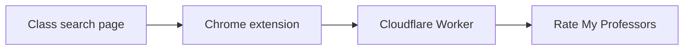

# Red Storm Professor Ratings

Unofficial Chrome extension. It is not affiliated with St. John's University, Rate My Professors, or Ellucian.

On the Banner 9 class-results grid, the extension reads the instructor, campus, and subject already on the row. It asks a Cloudflare Worker for a Rate My Professors score and draws that score under the name. The extension does not call St. John's servers, and it does not read session cookies or student records.



The page only paints. The Worker does the match, the caches, and the rate limit. Shared code in `shared/` is imported by both.

Start with [ARCHITECTURE.md](ARCHITECTURE.md). The first section is one diagram. The next section defines the words. The `docs/` folder is the contract for the coding agent. It is not the place to learn the system.

## Repository map

| Path | What lives there |
| --- | --- |
| `extension/` | Content script, service worker, popup, and styles. This is what runs in Chrome. |
| `worker/` | Cloudflare Worker. Routes, colo cache, KV, rate limit, Rate My Professors search, privacy page. |
| `shared/` | Types and rules both sides import. Names, campus, cache keys, batch size, ranking. |
| `docs/` | Agent reference. Product rules, Banner DOM notes, unpacked install steps. |
| `extension/test/`, `worker/test/`, `shared/test/` | Vitest. |
| `e2e/` | Playwright. Separate from `npm test`. |

## Checks

```bash
npm test
npm run typecheck
```

`npm test` does not call the production Worker or Rate My Professors. `npm run test:e2e` builds the extension and runs Playwright.

## Load the extension

```bash
npm run build:extension
```

Then follow [docs/unpacked-install.md](docs/unpacked-install.md). Load the `extension/` folder. `manifest.json` has to be inside the folder you select.

## Worker

```bash
npm run dev:worker
```

`npm run deploy:worker` publishes the Worker. That needs a Cloudflare account, and this repo does not run it for you. The Rate My Professors token is the Wrangler var `rmpToken`. It is not in the extension bundle and it is not committed. See the comment in `worker/wrangler.toml`.
